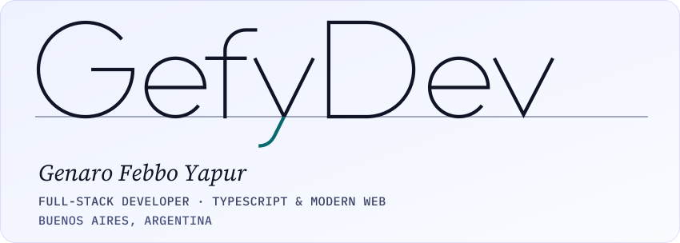

  <picture>
    <source media="(prefers-color-scheme: dark) and (max-width: 600px)" srcset="https://raw.githubusercontent.com/gefydev/gefydev/widgets-output/hero-m-dark.svg">
    <source media="(prefers-color-scheme: light) and (max-width: 600px)" srcset="https://raw.githubusercontent.com/gefydev/gefydev/widgets-output/hero-m-light.svg">
    <source media="(prefers-color-scheme: dark)" srcset="https://raw.githubusercontent.com/gefydev/gefydev/widgets-output/hero-dark.svg">
    
  </picture>

  <a href="https://www.linkedin.com/in/gefydev" target="_blank">LinkedIn</a>
  &nbsp;·&nbsp;
  <a href="https://gefy.dev" target="_blank">Portfolio</a>
  &nbsp;·&nbsp;
  <a href="mailto:hi@gefy.dev">hi@gefy.dev</a>

 

---

### 👨‍💻 About Me

Hey there! I'm **Genaro Febbo Yapur**, a Full-Stack developer from Buenos Aires, Argentina 🇦🇷. I specialize in crafting high-performance, accessible, and elegant digital products powered by modern architectures.

- 🚀 **Ecosystem:** Deeply immersed in **TypeScript**, **JavaScript**, and modern UI frameworks.
- 🛠️ **Core Stack:** **Astro**, **React**, **Next.js**, **Express**, **Node.js**, and **Tailwind CSS**.
- 🦀 **Exploring:** System programming with **Rust** and cloud automation.
- 💡 **Philosophy:** Building with clean architecture, continuous integration, and first-class developer experience.

 

---

### 🛠️ Tech Stack & Tooling

  <picture>
    <source media="(prefers-color-scheme: dark) and (max-width: 600px)" srcset="https://raw.githubusercontent.com/gefydev/gefydev/widgets-output/stack-m-dark.svg">
    <source media="(prefers-color-scheme: light) and (max-width: 600px)" srcset="https://raw.githubusercontent.com/gefydev/gefydev/widgets-output/stack-m-light.svg">
    <source media="(prefers-color-scheme: dark)" srcset="https://raw.githubusercontent.com/gefydev/gefydev/widgets-output/stack-dark.svg">
    
  </picture>

 

---

### 📊 Open Source & PR Contributions

  <picture>
    <source media="(prefers-color-scheme: dark) and (max-width: 600px)" srcset="https://raw.githubusercontent.com/gefydev/gefydev/widgets-output/prs-m-dark.svg">
    <source media="(prefers-color-scheme: light) and (max-width: 600px)" srcset="https://raw.githubusercontent.com/gefydev/gefydev/widgets-output/prs-m-light.svg">
    <source media="(prefers-color-scheme: dark)" srcset="https://raw.githubusercontent.com/gefydev/gefydev/widgets-output/prs-dark.svg">
    
  </picture>

 

---

### 📈 GitHub Metrics & Languages

  <picture>
    <source media="(prefers-color-scheme: dark)" srcset="https://raw.githubusercontent.com/gefydev/gefydev/widgets-output/stats-dark.svg">
    
  </picture><picture>
    <source media="(prefers-color-scheme: dark)" srcset="https://raw.githubusercontent.com/gefydev/gefydev/widgets-output/langs-dark.svg">
    
  </picture>

  <picture>
    <source media="(prefers-color-scheme: dark) and (max-width: 600px)" srcset="https://raw.githubusercontent.com/gefydev/gefydev/widgets-output/streak-m-dark.svg">
    <source media="(prefers-color-scheme: light) and (max-width: 600px)" srcset="https://raw.githubusercontent.com/gefydev/gefydev/widgets-output/streak-m-light.svg">
    <source media="(prefers-color-scheme: dark)" srcset="https://raw.githubusercontent.com/gefydev/gefydev/widgets-output/streak-dark.svg">
    
  </picture>

 

---

### 🧊 3D Contribution Graph & Activity

  <picture>
    <source media="(prefers-color-scheme: dark) and (max-width: 600px)" srcset="https://raw.githubusercontent.com/gefydev/gefydev/widgets-output/3d-m-dark.svg">
    <source media="(prefers-color-scheme: light) and (max-width: 600px)" srcset="https://raw.githubusercontent.com/gefydev/gefydev/widgets-output/3d-m-light.svg">
    <source media="(prefers-color-scheme: dark)" srcset="https://raw.githubusercontent.com/gefydev/gefydev/widgets-output/3d-dark.svg">
    
  </picture>

 

  <picture>
    <source media="(prefers-color-scheme: dark) and (max-width: 600px)" srcset="https://raw.githubusercontent.com/gefydev/gefydev/widgets-output/snake-m-dark.svg">
    <source media="(prefers-color-scheme: light) and (max-width: 600px)" srcset="https://raw.githubusercontent.com/gefydev/gefydev/widgets-output/snake-m-light.svg">
    <source media="(prefers-color-scheme: dark)" srcset="https://raw.githubusercontent.com/gefydev/gefydev/widgets-output/snake-dark.svg">
    
  </picture>

 

---

  

